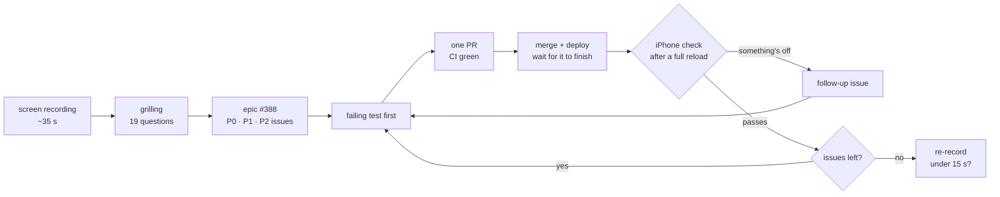
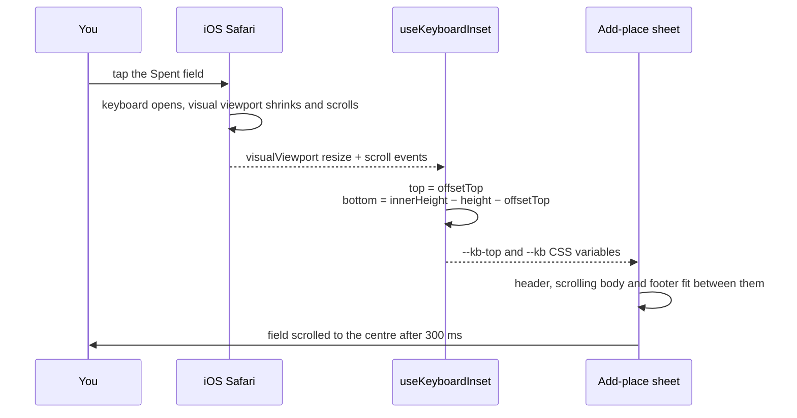
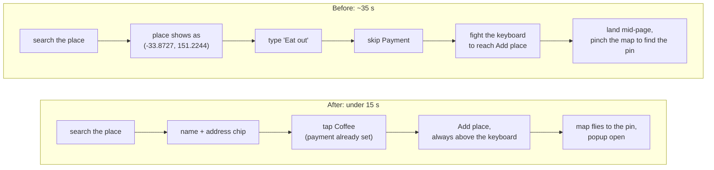

# 35 seconds to log a coffee: what one screen recording taught me about iPhone Safari

**Tags:** `webdev` `ios` `react` `ux`

**I asked my wife, who uses Places feature with me, to log a coffee run on her iPhone while recording the screen. It worked, and it took about 35 seconds, most of it spent fighting the form. Ten PRs later the same flow takes 10 seconds. Most of the fixes were one line long.**

> *"It works" and "it's fast" are different features.*

---

## Contents

- [The recording](#the-recording)
- [Grilled before coding](#grilled-before-coding)
- [Ten PRs, one at a time](#ten-prs-one-at-a-time)
- [Safari thought it was a card form](#safari-thought-it-was-a-card-form)
- [The keyboard ate the sheet](#the-keyboard-ate-the-sheet)
- [A comma that emptied the field](#a-comma-that-emptied-the-field)
- [A pinch that started in the wrong place](#a-pinch-that-started-in-the-wrong-place)
- [Fewer taps, not faster typing](#fewer-taps-not-faster-typing)
- [Try it yourself](#try-it-yourself)

---

## The recording

[luisfaria.dev](https://luisfaria.dev) has a private `/places` page: a Google Map of places we've been to together, with the date, what we spent and a note. It's Next.js with Apollo GraphQL, and it's built to be used on the spot, from a phone.

Going through the recording frame by frame:

- The keyboard pushed the form's header and close button off the top, and the **Add place** button hid behind the keyboard.
- Safari showed its key, card and location autofill icons, and suggested "Amex" in the Spent field.
- After picking a café from search, the place showed as `(-33.8727, 151.2244)`.
- Category was typed by hand, and Payment was skipped.
- After saving, the sheet closed halfway down the page, and she pinched the map to find the new pin.

**So what:** nothing in that list is a bug a test would catch. Every one of them is time.

<sub>[↑ Back to contents](#contents)</sub>

---

## Grilled before coding

Before touching any code I answered 19 design questions in two rounds: what ships first, which fixes are worth a billed Google API, what "done" means. The answer to the last one shaped everything else: **the same person records the same flow again, and it has to be under 15 seconds.**

That turned into one epic and ten issues, ranked P0 (feels broken), P1 (makes it fast) and P2 (polish). Each one was one PR, and each was checked on a real iPhone after deploy before the next one merged.

**So what:** a measurable finish line stopped the polish list from growing forever. Three of the four "nice to have" issues were later closed as not needed, because the goal had already been met.

The grilling came straight from Matt Pocock's Skill Repo. If you're not using it, check it out: [Skills For Real Engineers](https://github.com/mattpocock/skills)

<sub>[↑ Back to contents](#contents)</sub>

---

## Ten PRs, one at a time

Every issue went through the same loop. Nothing merged until the PR before it had been deployed and tried on the phone.



*Three of the PRs (#404, #407, #408) are follow-ups that came out of those iPhone checks.*

| PR | Priority | What it delivered |
|---|---|---|
| [#400](https://github.com/lfariabr/luisfaria.dev/pull/400) | P0 | Safari stops treating the pin form as a card form: no autofill icons, no "Amex" |
| [#401](https://github.com/lfariabr/luisfaria.dev/pull/401) | P0 | The add-place sheet stays above the iOS keyboard, with ✕ and **Add place** always in view |
| [#404](https://github.com/lfariabr/luisfaria.dev/pull/404) | Follow-up | No page pinch zoom when the pinch starts on the timeline |
| [#407](https://github.com/lfariabr/luisfaria.dev/pull/407) | Follow-up | **See more** adds 5 visits at a time instead of all of them |
| [#408](https://github.com/lfariabr/luisfaria.dev/pull/408) | Follow-up | Spent accepts a decimal comma (`4,50`) |
| [#409](https://github.com/lfariabr/luisfaria.dev/pull/409) | P0 | After saving: a toast, the map flies to the new pin, its popup opens and its timeline row rings |
| [#410](https://github.com/lfariabr/luisfaria.dev/pull/410) | P1 | The picked place shows as a name and address chip, not coordinates |
| [#411](https://github.com/lfariabr/luisfaria.dev/pull/411) | P1 | Tap-to-pick chips for category and payment, with the last payment preselected |
| [#412](https://github.com/lfariabr/luisfaria.dev/pull/412) | P1 | The notes box grows as you type |
| [#413](https://github.com/lfariabr/luisfaria.dev/pull/413) | P2 | Steady page load, the hint hides while a popup is open, 44px edit pencils |
| [#414](https://github.com/lfariabr/luisfaria.dev/pull/414) | Bonus | Full screen map with one-finger pan, including on iPhone Safari |

<sub>[↑ Back to contents](#contents)</sub>

---

## Safari thought it was a card form

Safari decides a form is a payment form from its field names and labels. A field called **Payment** next to an amount was enough. The fix:

```tsx
export const NO_AUTOFILL = { autoComplete: 'off', 'data-1p-ignore': true, 'data-lpignore': 'true' } as const;
```

That goes on every input, plus `autoComplete="off"` on the form and neutral `name`s (`paidWith`, `spent`). The label still says "Payment". Only the attributes Safari reads changed.

<sub>[↑ Back to contents](#contents)</sub>

---

## The keyboard ate the sheet

When the iOS keyboard opens, the layout viewport doesn't shrink. Safari scrolls the *visual* viewport instead, so a `position: fixed` sheet ends up partly behind the keyboard and partly above the top of the screen.

The `visualViewport` API reports both edges:

```ts
const top = vv.offsetTop;
const bottom = window.innerHeight - vv.height - vv.offsetTop;
```



*The layout viewport never changes, so CSS alone can't see the keyboard. The visual viewport can.*

The sheet pins itself between them through two CSS variables (`top-(--kb-top) bottom-(--kb)` in Tailwind 4). It has a fixed header, a scrolling body and a fixed footer, so ✕ and **Add place** stay in view while you type. Android gets the same result from `interactiveWidget: 'resizes-content'` in the Next.js viewport.

**So what:** I had first fixed only the bottom inset. The header still vanished, because iOS scrolls the visible area up as well. One iPhone check caught it.

<sub>[↑ Back to contents](#contents)</sub>

---

## A comma that emptied the field

Depending on the phone's region settings, the decimal key on the iPhone keyboard types a comma. A `type="number"` input given `4,50` reports an empty value, so the amount silently disappeared.

```tsx
<Input type="text" inputMode="decimal" />
```

The parser accepts both `,` and `.`. You still get the numeric keyboard, and the browser no longer decides what a number looks like.

<sub>[↑ Back to contents](#contents)</sub>

---

## A pinch that started in the wrong place

iOS Safari ignores `user-scalable=no`. Cancelling `gesturestart` stopped most page pinches, but not one that started on the timeline below the map. iOS makes a touch's moves uncancelable once it has begun as a scroll.

```ts
document.documentElement.style.touchAction = 'pan-x pan-y';
```

That tells the browser never to start a page pinch, while one finger still scrolls. The map handles its own touches, so pinching it still zooms the map.

<sub>[↑ Back to contents](#contents)</sub>

---

## Fewer taps, not faster typing

The P1 fixes were about not typing at all:



*Typing became tapping, and the hunt for the new pin went away.*

- **Place chip.** After a search, the place shows as name and address with a **Change** button. Places API (New) `shortFormattedAddress` is an Essentials field, so it adds no cost.
- **Tap-to-pick chips.** Category and payment are chips built from past entries, and payment starts on the one used last.
- **Notes that grow**, with `field-sizing: content` and a fallback.
- **Fly to the new pin.** After saving, a toast appears, the map pans to the pin with its popup open, and the new timeline row rings briefly.

Afterwards I added one feature that wasn't in the brief: a full screen map where one finger pans. Google's own full screen button needs the Fullscreen API, which iPhone Safari doesn't have for page elements, so it's a fixed layer instead.

<sub>[↑ Back to contents](#contents)</sub>

---

## Try it yourself

- Record a real person doing the one thing your app is for, on their own phone, and time it.
- Write the time down as the acceptance criterion, not "make it smoother".
- Check every iOS fix on a device after deploy, after a full reload.

The code is open source: [github.com/lfariabr/luisfaria.dev](https://github.com/lfariabr/luisfaria.dev). The epic is [#388](https://github.com/lfariabr/luisfaria.dev/issues/388), and there's a [guide to run your own Places map](https://github.com/lfariabr/luisfaria.dev/blob/master/_docs/guides/run-your-own-places-map.md).
