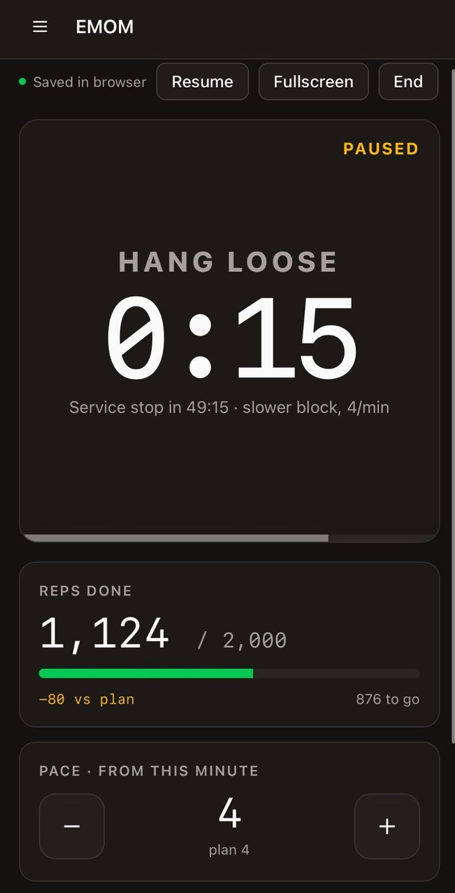

# I attempted 2,000 pull-ups. The next morning, I open-sourced my timer.

**Tags:** `buildinpublic` `nextjs` `react` `opensource`



On October 24, I attempted **2,000 pull-ups in eight hours**. I stopped at **1,124**, about five hours and twenty minutes in.

That was 124 more than my previous personal record. It was also **876 short of the goal. A failed attempt.** Both belong in the record.

I ran the whole session on an EMOM timer I had built inside my portfolio. EMOM means *every minute on the minute*: at the top of each minute, do the planned reps, then rest for whatever is left of it. The next morning, I started extracting that timer into a free, open-source app.

It now runs at [emom-pullups.vercel.app](https://emom-pullups.vercel.app). No account. Your training data stays in your browser.

This post is about what moving it out of a private page took, and what the import list did not tell me. First, the attempt.

## The attempt

I call the goal *The Beast*. I built toward it like a marathon: a regular base, progressively longer weekend sessions, back-offs, a dress rehearsal, then a taper.

| Date | Pull-ups | Place in the build |
|------|----------|--------------------|
| Aug 02 | 450 | First long session of the build |
| Oct 11 | 1,000 | The half-beast, roughly 4h20 elapsed |
| Oct 18 | 200 | Back-off and equipment check |
| Oct 24 | 1,124 | The attempt, stopped short of 2,000 |

My longest rehearsal was half the goal, completed once, thirteen days before the attempt. It had already shown the warning: the pace faded around 690 reps. On October 24, fatigue arrived in the third block again. The first two blocks gave me 500 reps; the next four added 214, 206, 200, and finally 4.

At 1,124, my left biceps was one set away from an injury. I stopped. The next attempt is deferred to 2027.

## Why I built a timer

General interval timers handle "work X, rest Y" well. My sessions needed something narrower: several long work blocks with stops between them, a different number of reps per minute in each block, and a record of what I actually completed, including the short minutes.

**The screen and the beeps were the most useful part.** Every minute had an external cue I could hear without watching the clock. Over five hours, that kept the cadence visible and kept me accountable to the plan.

When I could no longer hold the pace, the timer had to follow me. That requirement came from the half-beast: on October 11, I logged that a changed reps-per-minute value should become the new baseline, not a one-off correction.

The app also keeps the screen awake where supported, resumes an unfinished session after a refresh, tracks a monthly goal, and produces a Markdown row for my training log at the end.

The timer helped me execute and record the attempt. It could not make the training sufficient for 2,000.

## The imports said it was easy to move

The timer lived at `/admin/emom` on my portfolio, behind a login. It was built for an audience of one.

Before extracting it, I checked what it imported: three UI components, a styling helper, icons, and its own planning and storage modules. No Apollo, no GraphQL, no backend requests. The plan, session history, and live snapshot were already in `localStorage`.

So I created a fresh Next.js app, copied the timer and its dependencies, and served it at `/`. The tracker reads browser storage when it loads, so a `next/dynamic` wrapper with `ssr: false` keeps it out of server rendering.

The timing logic was already pure functions in `src/lib/emom/plan.ts`, tested separately from the interface. This is how The Beast preset reaches 2,000 when its eight planned blocks add up to 1,900:

```ts
export const extraMinutes = (cfg: EmomConfig) => {
  const planned = planReps(cfg);
  return cfg.goal > planned ? Math.ceil((cfg.goal - planned) / lastRate(cfg)) : 0;
};
```

Twenty-five extra minutes at four a minute. Writing this post, I noticed the preset was still labelled "8h" while its own duration function returned 505 minutes. It is now labelled by its goal instead.

The imports were half right. Three dependencies did not appear in them.

### 1. The layout

The live session bar was `sticky top-14`, an offset for the portfolio's mobile admin header. The new app has no header, so the bar sat 56px down the screen and covered the counter. I only found it on a phone.

```diff
- <div className="sticky top-14 z-30 ...">
+ <div className="sticky top-0 z-30 ...">
```

### 2. The defaults, and the tests that agreed with them

A first visit opened on my workout: four 50-minute blocks at five reps a minute. The monthly goal was a hard-coded 2,000. Neither looks like a dependency, and both were wrong for anyone else.

The public default is now two 20-minute blocks at three a minute with a five-minute break: 120 reps in 45 minutes. The monthly goal is a saved setting, defaulting to 1,000.

Changing the default broke five component tests that expected the old plan. They were not only testing the tracker; they were testing my assumptions. I seeded the old plan explicitly where those tests needed it and added coverage for the public default and the saved monthly goal.

### 3. The pipeline

GitHub CI passing did not mean the public app had updated. The Vercel project was not connected to the repository, so merging a PR did not trigger a deployment, and I deployed manually through the CLI. I connected it afterwards; merges now deploy.

## What is still mine

The app is still called Beast EMOM, and I am keeping that: it is where it came from. But the breaks are still called service stops, and the summary still writes a Markdown row shaped for my own training table. Both are open issues, and both are small.

## What comes next

The Beast log keeps the failed attempt and the evidence for the next plan. Pacing, progression, and hand protection all need work before 2027. I am not treating another date on the calendar as proof that the preparation is enough.

The app is public now because its usefulness did not depend on me completing the goal. It helped me follow the minutes and keep an honest record of the session I actually did.

- **Try it:** [emom-pullups.vercel.app](https://emom-pullups.vercel.app).
- **Read the code:** [github.com/lfariabr/emom-pullups](https://github.com/lfariabr/emom-pullups), MIT-licensed.
- **Pick up a first issue:** [the `good first issue` label](https://github.com/lfariabr/emom-pullups/labels/good%20first%20issue) has neutral wording for breaks and a choice of summary formats.
- **Tell me what happens in your sessions:** which part of planning, pacing, or logging gets awkward when you use a general interval timer?

The record is 1,124. The target was 2,000. The next build starts with understanding the gap.
