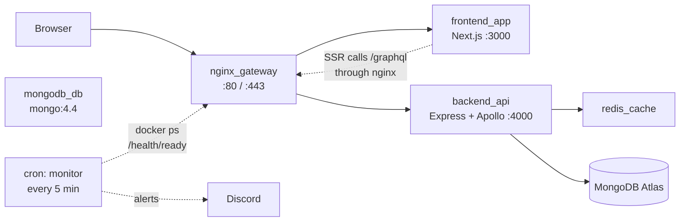
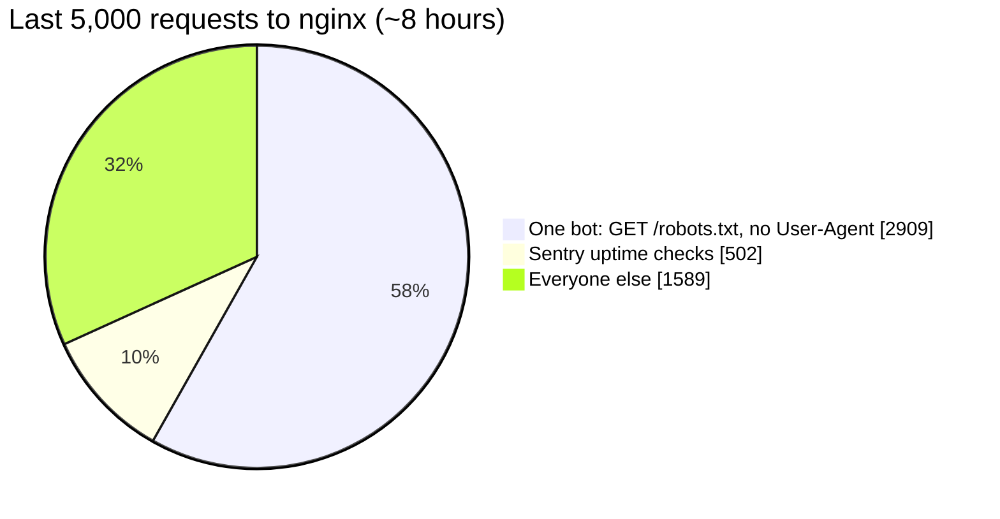
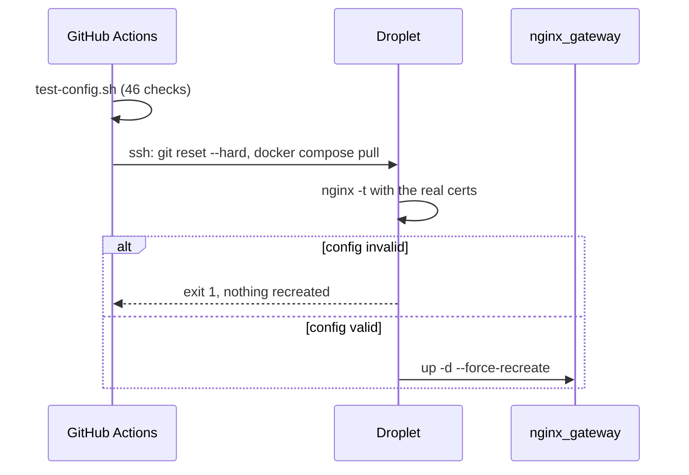
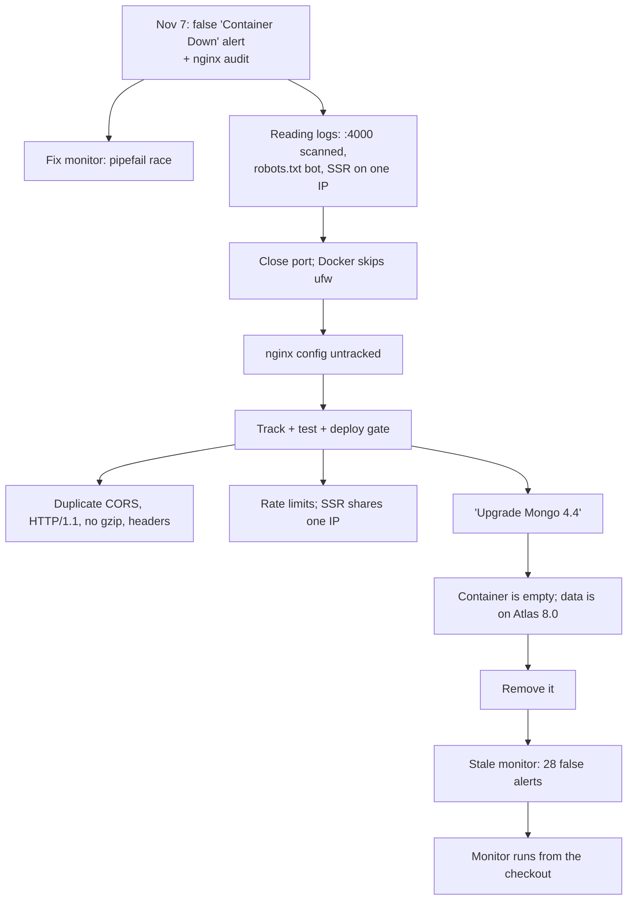

# My server didn't go down. Chasing the false alarm hardened everything else.

**Tags:** `buildinpublic` `devops` `nginx` `docker`

On November 7, Discord pinged me: **🔴 Container(s) Down: backend_api.** I opened my site on my phone and it didn't load. That looked like proof.

It wasn't. I asked Claude Code to SSH into the droplet and read the logs. Every container had been up the whole time. My phone's 4G had dropped out, and the alert was false.

That should have been a five-minute investigation. It turned into two days and 13 pull requests, because every fix exposed the next thing nobody had looked at. This post is the trail: what was wrong, how each fix was checked on the live server, and the surprises, which taught me more than the plan did.

---

## Contents

- [The setup](#the-setup)
- [13 PRs at a glance](#13-prs-at-a-glance)
- [1. The alert that cried wolf](#1-the-alert-that-cried-wolf)
- [2. What the logs said](#2-what-the-logs-said)
- [3. The config that only lived on the server](#3-the-config-that-only-lived-on-the-server)
- [4. The header I sent twice](#4-the-header-i-sent-twice)
- [5. Rate limits, and the IP everyone shares](#5-rate-limits-and-the-ip-everyone-shares)
- [6. The upgrade that wasn't](#6-the-upgrade-that-wasnt)
- [7. The last surprise: Sentry was slow, not broken](#7-the-last-surprise-sentry-was-slow-not-broken)
- [What I'd tell myself on November 6](#what-id-tell-myself-on-november-6)
- [Try it yourself](#try-it-yourself)

---

## The setup

My portfolio, [luisfaria.dev](https://luisfaria.dev), runs on one DigitalOcean droplet: 1 vCPU, 2 GB of RAM, Docker Compose. CI deploys by SSHing in, running `git reset --hard origin/master`, pulling images and recreating the containers.



*Fig 1 - The stack as it was on November 7. Keep an eye on `mongodb_db`: nothing points at it.*

One rule held for the whole cleanup: **verify on the live server before changing anything, then verify again after the deploy.** One change per PR, with an issue first, and I merged each one myself.

<sub>[↑ Back to contents](#contents)</sub>

---

## 13 PRs at a glance

One issue and one PR per change, each checked on the live server after its deploy before the next one merged.

| PR | Section | What it did |
|---|---|---|
| [#454](https://github.com/lfariabr/luisfaria.dev/pull/454) | 2 | Stopped publishing the backend's port `4000`: it was reachable from the internet, past `ufw` |
| [#461](https://github.com/lfariabr/luisfaria.dev/pull/461) | 2 | Capped container logs at 3 × 10 MB each, so logs can't fill the disk |
| [#463](https://github.com/lfariabr/luisfaria.dev/pull/463) | 1 | Fixed the false "Container(s) Down" alerts (`pipefail` race); alert after 2 failures in a row, recovery message; monitor in git with a CI test |
| [#465](https://github.com/lfariabr/luisfaria.dev/pull/465) | 3 | Tracked the nginx config in git, with a routing test in CI and `nginx -t` before every deploy; bare-IP and unknown hosts get no reply |
| [#466](https://github.com/lfariabr/luisfaria.dev/pull/466) | 4 | Express owns CORS, so `/graphql` sends one `Access-Control-Allow-Origin` instead of two |
| [#467](https://github.com/lfariabr/luisfaria.dev/pull/467) | 4 | HTTP/2 and gzip: `/graphql` responses 53% smaller, `/articles` Lighthouse 88 → 97 |
| [#469](https://github.com/lfariabr/luisfaria.dev/pull/469) | — | Release notes for [v3.31.0](https://github.com/lfariabr/luisfaria.dev/releases/tag/v3.31.0) |
| [#470](https://github.com/lfariabr/luisfaria.dev/pull/470) | 4 | Tighter CSP and security headers; nginx version and `X-Powered-By` hidden; Sentry allowed through |
| [#471](https://github.com/lfariabr/luisfaria.dev/pull/471) | 5 | Edge rate limits for `/api/discord` and `/graphql` (SSR exempt); bots with no User-Agent dropped and not logged |
| [#472](https://github.com/lfariabr/luisfaria.dev/pull/472) | 6 | Removed the unused `mongo:4.4` container: production data was on Atlas 8.0 all along |
| [#474](https://github.com/lfariabr/luisfaria.dev/pull/474) | 6 | The monitor runs from the git checkout, so a deploy can't leave it stale |
| [#475](https://github.com/lfariabr/luisfaria.dev/pull/475) | 7 | Sentry starts in the browser again (`instrumentation-client.ts`), with cookies scrubbed from server events |
| [#478](https://github.com/lfariabr/luisfaria.dev/pull/478) | 7 | Malformed client requests no longer page me through Sentry |

<sub>[↑ Back to contents](#contents)</sub>

---

## 1. The alert that cried wolf

The monitor is a bash script that cron runs every 5 minutes. It checks CPU, memory, disk, the five containers and the API's `/health/ready`, and posts to Discord when something is off.

The container check looked like this:

```bash
set -o pipefail
for c in $EXPECTED_CONTAINERS; do
  if ! echo "$running" | grep -q "$c"; then
    missing+=("$c")
  fi
done
```

`grep -q` exits at the first match. If it exits before `echo` has finished writing, `echo` can be killed by `SIGPIPE`. With `pipefail` on, that counts as a failed pipeline, so the `if` reported a running container as missing. It happened only now and then, which is why the alerts looked random.

The fix had three parts:
- a here-string instead of a pipe: `grep -qxF -- "$c" <<< "$running"`;
- an alert only after **2 failures in a row**, plus a "✅ passing again" message on recovery;
- the script moved into the repo (`ops/monitor/`) with a stubbed test in CI: 25 checks, from a first miss to a corrupt counter file.

<sub>[↑ Back to contents](#contents)</sub>

---

## 2. What the logs said

That same morning I'd started an audit of the nginx config, and proving the server hadn't gone down meant reading its logs properly for the first time. Two logs, two very different pictures.

**nginx: the last 5,000 requests covered only about eight hours** (Nov 6, 18:04 to Nov 7, 02:26 UTC). Here's who sent them:



*Fig 2 - More than half of all traffic was a single bot asking for the same file.*

- **One IP made 2,909 of them, 58%.** Every one was `GET http://luisfaria.dev/robots.txt` with no User-Agent at all, and every one got a `301` to HTTPS, which it never followed. That's about 6 a minute, all night, for a file it never received.
- **Sentry's uptime checker made 502.** That one is mine: one check a minute, working as intended.
- **The rest was mostly crawlers and scanners** with fake browser User-Agents, many claiming versions of Chrome from years ago (Chrome 51, from 2016).

**The backend: someone was talking to it directly.** The backend log showed **324 requests from one scanner IP**, probing for credential files like `/~/.boto` (Google Cloud's config file). None of them appear in nginx's log. They reached Express on port `4000` straight from the internet, and Express answered: 322 × `404`, 2 × `415`.

Nothing leaked. There's no such file, and a spoofed `X-Forwarded-For` header didn't unlock the protected `/health/details` endpoint either (`403`). But the backend shouldn't have been reachable at all: `ufw` only allowed 22, 80 and 443.

Then I learned this: **ports Docker publishes skip `ufw`.** Docker writes its own iptables rules, and the `DOCKER-USER` chain was empty. `ports: - "4000:4000"` in Compose had quietly put the API on the public internet, bypassing nginx's TLS, headers and logs as well as the firewall.

**Most of the backend's own traffic came from one private IP, `172.18.0.1`: 402 requests, User-Agent `node`.** That's my frontend's server-side rendering calling `/graphql` through the Docker bridge. It mattered later, for rate limiting.

**The cert-renewal log had a warning nobody read.** The twice-daily renewal reloads nginx, and every reload printed `duplicate value "TLSv1.2"`: the config set `ssl_protocols` twice. Harmless, but proof that nobody had read that log. The certificate itself was fine: the one on disk matched the one nginx served, valid until January 2027.

Two things I expected to be broken weren't. nginx sees real client IPs (no IPv6 or proxy masking every visitor as one address), so the backend's per-IP rate limits were counting the right people.

**The fix for port 4000 was one deleted line.** nginx reaches the backend as `backend_api:4000` over the Compose network, so the port mapping wasn't needed at all. From outside, the port now times out. In the same pass, container logs got a cap (3 × 10 MB per container) so they can't fill the disk.

<sub>[↑ Back to contents](#contents)</sub>

---

## 3. The config that only lived on the server

The nginx config wasn't in git. It existed only as `nginx/conf/default.conf` on the droplet, next to four hand-made backups (`.bak_pre_webhooks_09102026_0617`, and so on). Every change had been a hand edit over SSH.

Tracking it meant writing a test that could actually prove things. `ops/nginx/test-config.sh` runs the real config in Docker:
- a self-signed certificate at the Let's Encrypt path;
- stub upstreams that answer `frontend /path` or `backend /path`, so each route's destination is checked;
- `nginx -t` must print no warnings.

And the deploy got a gate:



*Fig 3 - A bad nginx config now fails the deploy before the running gateway is replaced.*

Two fixes came along with it.

**Requests to the bare IP and unknown hosts get no reply.** Before, `http://<droplet-ip>/` was redirected to the site, which helps scanners map it. Now port 80 answers `return 444` (close the connection) and port 443 uses `ssl_reject_handshake on`.

The test proves the *rejection*, not just silence. Curl exit code 52 means "empty reply" and 35 means "TLS handshake failed". Checking for "no response" would also pass if nginx were simply down.

**Scanner paths return 404 without catching real slugs.** The old rule matched `\.git` anywhere in the URL, so an article slug like `foo.github.io` would have been blocked too. The new one is anchored, and a test covers exactly that slug.

<sub>[↑ Back to contents](#contents)</sub>

---

## 4. The header I sent twice

With the config in git, problems in it became easy to see. nginx added CORS headers to every response, and Express's `cors()` added them again on `/graphql`:

```text
Access-Control-Allow-Origin: https://luisfaria.dev
Access-Control-Allow-Credentials: true
Access-Control-Allow-Origin: https://luisfaria.dev
```

Browsers reject a response with two of those. It never broke anything only because the site calls `/graphql` from its own origin. Express now owns CORS, preflight included.

Then the cheap wins:

| | Before | After |
|---|---|---|
| Protocol | HTTP/1.1 | HTTP/2 |
| `/graphql` articles response | 4,322 bytes | 2,041 bytes (gzip) |
| Lighthouse `/articles` (mobile, median of 3) | 88 | 97 |
| `Server` header | `nginx/1.31.8` | `nginx` |
| `X-Powered-By` | `Next.js`, `Express` | hidden |
| `Permissions-Policy` | missing | camera, mic, geolocation, payment, USB denied |

The homepage stayed around 90 to 92. Its score is held back by JavaScript execution, which transport changes don't touch, so I didn't claim it.

<sub>[↑ Back to contents](#contents)</sub>

---

## 5. Rate limits, and the IP everyone shares

The last nginx change was edge rate limiting:
- `/api/discord`: 5 a minute per IP;
- `/graphql`: a 30-requests-a-second flood backstop in front of the backend's own Redis limits;
- port 80 requests with no User-Agent at all: closed without a reply, and not logged. That's the `/robots.txt` bot from section 2, which no longer fills the log.

The trap was the IP from section 2: server-side rendering calls `https://luisfaria.dev/graphql` through the Docker bridge, so to nginx **every SSR request comes from one IP, `172.18.0.1`**. The live log showed 23 `/graphql` requests from it in a single minute. A per-IP limit would have throttled my own server first.

```nginx
geo $limit_client {
    default        $binary_remote_addr;
    172.16.0.0/12  "";   # Docker bridge: SSR traffic, never limited
    # ...loopback and the other private ranges too
}
limit_req_zone $limit_client zone=graphql:10m rate=30r/s;
```

An empty key is never limited. The test was the interesting part: test clients also connect from a private Docker IP, so they were exempt too, and every limit test passed without testing anything. The fix was to put the test network on a CGNAT subnet (`100.64.250.0/24`) so test clients count as real visitors. A second, private network stands in for SSR, and the test checks it never sees a 429.

One more lesson from that test: it first passed only because Docker happened to reuse a client's IP between two containers. Locally it was green; on CI it would have been flaky. Both requests now come from one container.

<sub>[↑ Back to contents](#contents)</sub>

---

## 6. The upgrade that wasn't

Issue #444 said: "upgrade MongoDB from 4.4 (end of life)". The plan was a careful step-by-step upgrade (4.4 → 5.0 → 6.0 → 7.0), with a backup and a rehearsal first.

Before writing a migration, we checked what was actually in the database:

```text
admin  40960
config 12288
local  147456
```

No app database at all. The backend's `MONGODB_URI` pointed at **MongoDB Atlas**, already on **8.0**. Production data had never been on that container. It was a leftover from early development, running end-of-life MongoDB and taking 112 MB of a 2 GB server, for nothing.

So the fix was a deletion. CI also kept testing on `mongo:7`, because `mongo:8` now refuses to start on Linux kernels 6.19 and newer (MongoDB's [SERVER-121912](https://jira.mongodb.org/browse/SERVER-121912)), and the GitHub runners have moved past that.

**Then the cleanup bit back.** The monitor ran from a copy in `/opt/monitor` that I'd installed by hand, and the deploy never updated it. It still expected `mongodb_db`, so it reported it down every 5 minutes: **28 false alerts** before the new version went in. The cure for false alerts had caused new false alerts.

The fix was structural: cron now runs the monitor straight from the deploy's git checkout, so a deploy can't leave it behind.



*Fig 4 - Each fix exposed the next problem. The trail ends where it started: a false alert.*

The old volumes went too, about 950 MB of them. One looked like it might be a forgotten copy of real data: `backend_mongo-data` had five collections named after mine (`articles`, `users`, `chatmessages`, and more). Before deleting it, we copied it and opened the copy with a throwaway MongoDB:

```text
DB portfolio
   articles      0 docs
   chatmessages  0 docs
   projects      0 docs
   screams       0 docs
   users         0 docs
```

Empty, so it was safe to delete. Most of the 450 MB was MongoDB's journal and diagnostic logs.

<sub>[↑ Back to contents](#contents)</sub>

---

## 7. The last surprise: Sentry was slow, not broken

Checking the new security headers led to one more find. **Browser errors hadn't reached Sentry since March.** Sentry's client setup lived in `sentry.client.config.ts`, which only the `withSentryConfig` wrapper ever loaded, and I'd removed that wrapper in March to fix a build. Next.js 15.3+ loads `src/instrumentation-client.ts` on its own, so the fix was to move the setup there.

On the live site, a thrown error was now captured and posted to Sentry, and Sentry answered `200`. Then nothing. No issue, no event, and usage stats at zero: not accepted, not filtered, not rate limited, not dropped. We checked the DSN, the client key, the inbound filters and the plan's quota, and wrote it up as a support ticket waiting to happen.

The next morning, Sentry emailed me: the test errors had arrived, hours late. Nothing was broken. Sentry had just been slow. I'd written "Sentry is discarding my errors" into this post's first draft, and I'd have been wrong in public.

Those emails also surfaced the noise that had been there all along: a backend `BadRequestError` with **61 events over 6 months**. Each was a client posting a malformed request to `/graphql`, which Apollo already rejects with a `400`. That's the client's fault, not a bug in my code, so Apollo's client-error codes (`BAD_REQUEST`, `GRAPHQL_PARSE_FAILED`, `GRAPHQL_VALIDATION_FAILED`) joined the list of codes that never page me.

<sub>[↑ Back to contents](#contents)</sub>

---

## What I'd tell myself on November 6

- **Check the live system before you plan.** The MongoDB upgrade would have been a careful migration of an empty database. One query saved it.
- **Config that lives only on a server goes stale without anyone noticing.** nginx, the monitor, and next on the list, the cert renewal script ([#476](https://github.com/lfariabr/luisfaria.dev/issues/476)).
- **A test that can't fail proves nothing.** Rate-limit tests from an exempt IP, "no response" checks, a pass that depended on IP reuse: each looked green and tested nothing until it was made able to fail.
- **Docker publishes ports past your firewall.** If a service doesn't need to be public, don't map its port.
- **A silent dashboard isn't proof of loss.** Sentry answered `200` and showed nothing for hours. Give the pipeline time before calling it broken.

An AI agent did most of the typing and the SSH. It also made mistakes. It suggested a second Sentry uptime monitor, which used up the free plan's one monitor for the month. It missed that a merge removed a container the hand-installed monitor still expected. It also tried to put my Atlas cluster's hostname in a public PR, and Claude Code's own permission check stopped it. The value came from the loop, not from any single answer: verify, change one thing, verify again.

<sub>[↑ Back to contents](#contents)</sub>

---

## Try it yourself

Two commands worth running on any Docker host:

```bash
# Which ports are published, past your firewall?
docker ps --format '{{.Names}}\t{{.Ports}}' | grep 0.0.0.0

# Which files in the deploy directory aren't in git?
git -C /path/to/deploy status --short --ignored
```

- **The repo:** [github.com/lfariabr/luisfaria.dev](https://github.com/lfariabr/luisfaria.dev)
- **The release:** [v3.31.0 — Security & infra hardening](https://github.com/lfariabr/luisfaria.dev/releases/tag/v3.31.0)
- **The nginx test:** [`ops/nginx/test-config.sh`](https://github.com/lfariabr/luisfaria.dev/blob/master/ops/nginx/test-config.sh)

What's running on *your* server that only exists on your server?

<sub>[↑ Back to contents](#contents)</sub>

---

## Let's connect

- **GitHub:** [github.com/lfariabr](https://github.com/lfariabr)
- **LinkedIn:** [linkedin.com/in/lfariabr](https://www.linkedin.com/in/lfariabr/)
- **Portfolio:** [luisfaria.dev](https://luisfaria.dev)

*Verify live, change one thing, verify again.*
